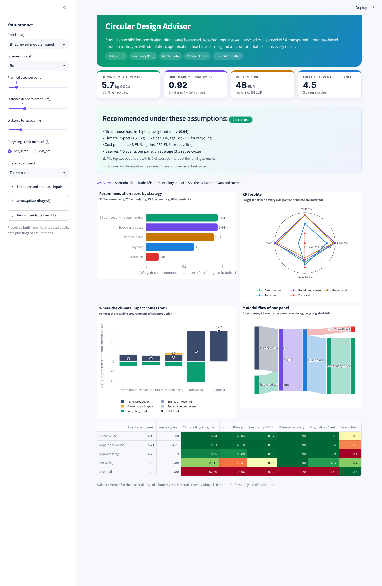
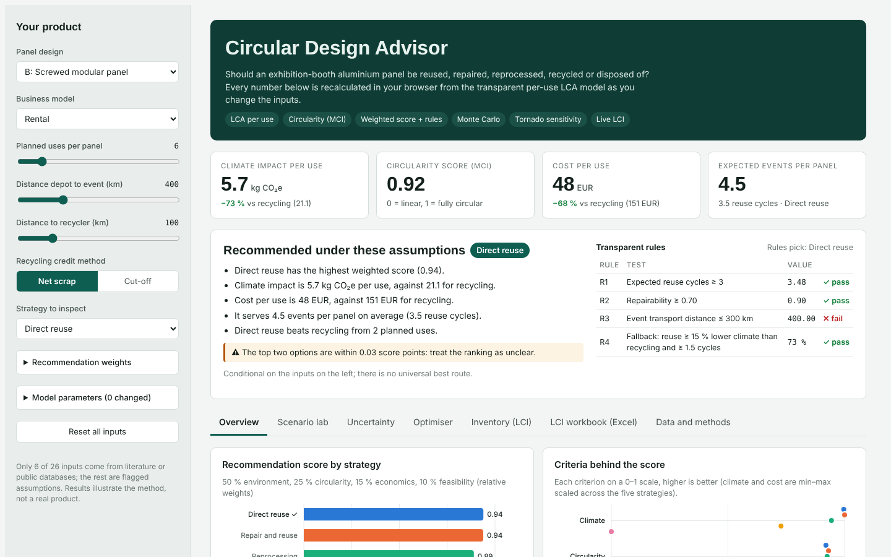
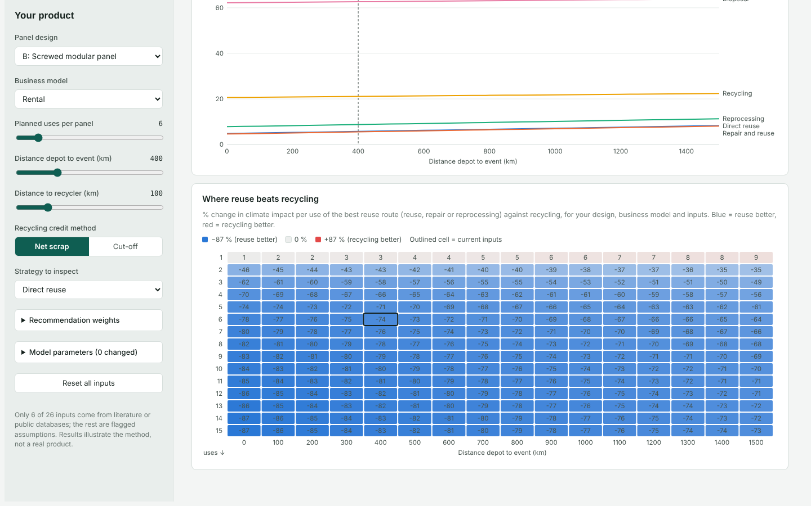
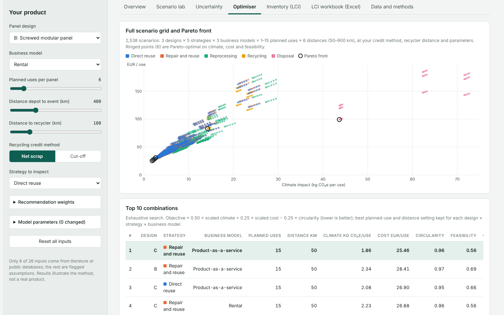
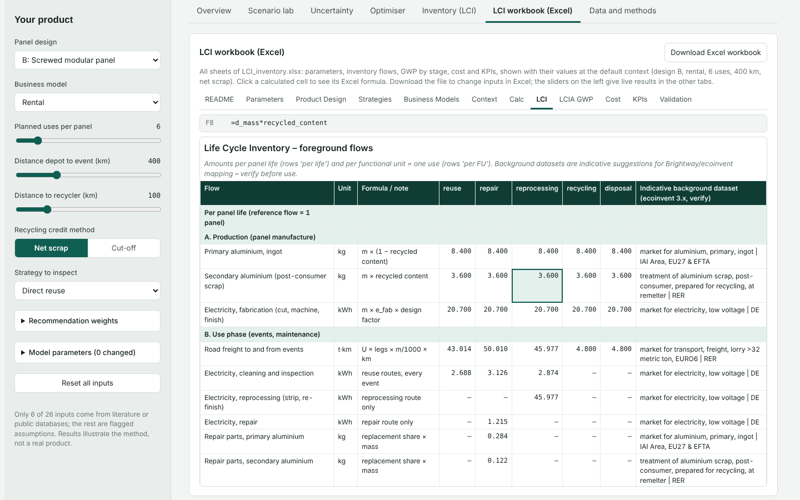
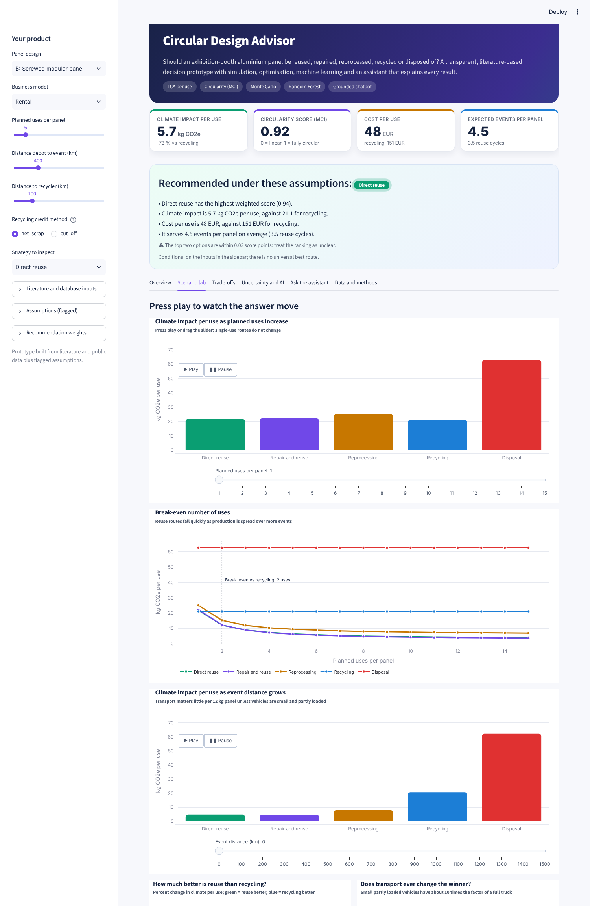
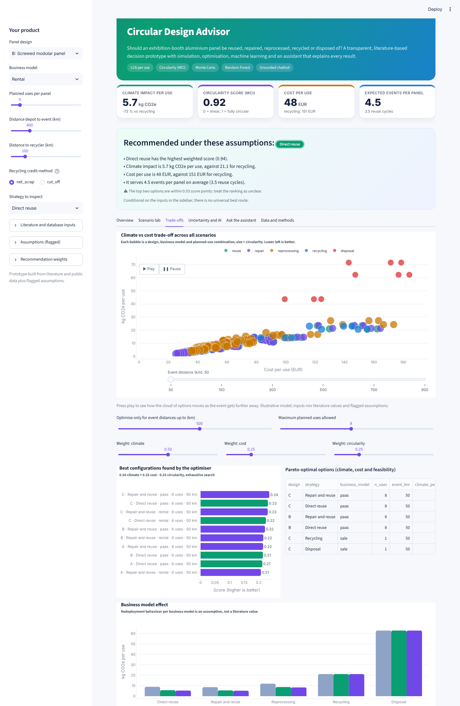
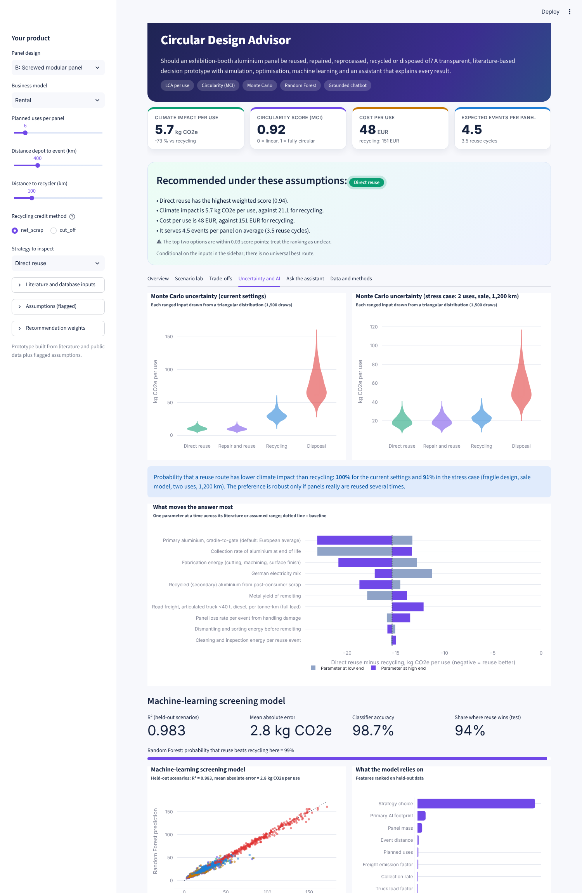
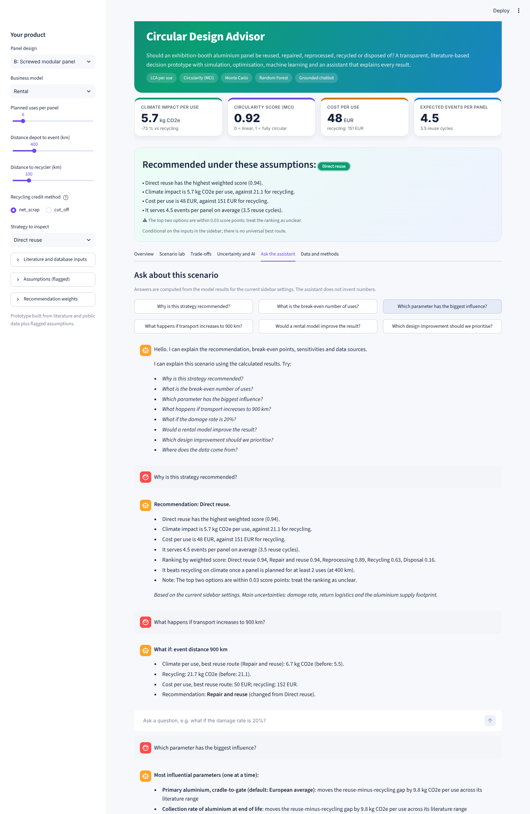

# Circular Design Advisor

**A literature-based, animated decision dashboard for reuse, repair, reprocessing, recycling and disposal of a modular exhibition-booth aluminium panel.**
It chains product and lifecycle data, per-use LCA, circularity KPIs, simulation, optimisation, machine learning and a chatbot that explains the calculated results.

> **Read this first.** Only 6 of 26 model inputs come from literature or public databases (European Aluminium, IAI, Hydro, Umweltbundesamt, GLEC). The other 20, including damage rate, costs, design archetypes and business-model behaviour, are flagged assumptions. Results illustrate the method, not a real product.



## Three ways to use it

| | What | How to open | Needs |
|---|---|---|---|
| 1 | **Offline dashboard** – fully interactive: sliders, scenario lab, Monte Carlo, optimiser, live LCI, and the whole Excel LCI workbook as a tab (with the .xlsx download built in) | Download the [**offline pack (zip)**](https://github.com/malleshkomal/circular-design-advisor/raw/main/outputs/circular-design-advisor-offline.zip), unzip, double-click `dashboard_offline.html` | A web browser only |
| 2 | **LCI workbook** – formula-driven Excel inventory, GWP by stage, cost, KPIs | Download [`outputs/LCI_inventory.xlsx`](https://github.com/malleshkomal/circular-design-advisor/raw/main/outputs/LCI_inventory.xlsx) | Excel or LibreOffice |
| 2b | **LCI workbook viewer** – every sheet of the workbook in the browser; click a cell to see its formula | In the same [offline pack (zip)](https://github.com/malleshkomal/circular-design-advisor/raw/main/outputs/circular-design-advisor-offline.zip): double-click `lci_workbook.html` | A web browser only |
| 3 | **Streamlit app** – the full Python version, including machine learning and the assistant | `streamlit run app.py` | Python + `requirements.txt` |

`dashboard_offline.html` is self-contained: it also shows every sheet of the LCI workbook and can save the .xlsx, so that one file is enough. Opening an `.html` file straight from a GitHub link shows its source code, so use the zip (or, in a clone, open the files in `outputs/`). `outputs/dashboard_static.html` is an older animated, non-interactive export.

## What is inside

| Layer | What it does |
|---|---|
| Data | `data/literature_sources.csv` (value, range, type, quality, source, URL), `product_data.csv`, `business_models.csv`, `strategies.csv` |
| LCA model | Climate, cost and circularity **per use** of one panel for five strategies; net-scrap or cut-off recycling credit |
| KPIs | Climate per use, circularity (simplified Material Circularity Indicator), material recovery, reuse cycles, cost, feasibility, virgin aluminium |
| Simulation | 2,538-scenario grid, uses and distance sweeps, percent-gap heatmaps |
| Uncertainty | 1,500-draw Monte Carlo over literature ranges, tornado chart |
| Optimisation | Exhaustive search of the decision space plus a Pareto front (climate, cost, feasibility) |
| Machine learning | Random Forest surrogate (R² 0.99) and a "does reuse beat recycling?" classifier |
| Recommendation | Weighted score (0.50 / 0.25 / 0.15 / 0.10) plus transparent rules; disagreements are flagged |
| Assistant | Rule-based chatbot grounded in the model output; optional LLM wrapper that may only rephrase |
| Dashboard | Streamlit with animated Plotly charts (press play), count-up KPI cards, streaming chat |
| Offline dashboard | `outputs/dashboard_offline.html`: JavaScript port of the model (`web/model.js`) that reproduces the Python results exactly; everything except the ML and the chatbot |
| LCI workbook | `outputs/LCI_inventory.xlsx`: flows per panel life and per use, GWP by stage, cost, KPIs and a validation sheet against the Python model |

### Offline dashboard



| Scenario lab: where reuse beats recycling | Optimiser: 2,538 scenarios and Pareto front |
|---|---|
|  |  |



### Streamlit app

| Scenario lab (animated) | Trade-offs |
|---|---|
|  |  |

| Uncertainty and AI | Assistant |
|---|---|
|  |  |

## Quick start

```bash
pip install -r requirements.txt
streamlit run app.py                     # Streamlit dashboard
python scripts/run_analysis.py           # results/, ML model, outputs/dashboard_static.html
python scripts/build_dashboard.py        # outputs/dashboard_offline.html (after changing data/ or web/)
python scripts/build_lci_workbook.py     # outputs/LCI_inventory.xlsx (open and save in Excel to recalculate)
python scripts/build_lci_viewer.py       # outputs/lci_workbook.html (from the recalculated workbook)
python scripts/package_offline.py        # outputs/circular-design-advisor-offline.zip
pytest                                   # 19 tests, incl. JavaScript-vs-Python check (needs Node.js)
```

The first dashboard start trains the ML models if `results/ml_model.joblib` is missing (about 30 seconds).

Optional: set `ANTHROPIC_API_KEY` to let an LLM rephrase chatbot answers (`CHATBOT_LLM_MODEL` selects the model). The numbers always come from the model; this wrapper is untested in this repository.

## Project structure

```
circular-design-advisor/
├── index.html                Landing page for GitHub Pages (links to the pages in outputs/)
├── app.py                    Streamlit dashboard (entry point)
├── data/                     Model inputs: parameters with sources, designs, strategies, business models
├── src/cirdesign/            Python model: LCA per use, KPIs, analysis, recommendation, ML, chatbot, charts
├── web/                      Source of the offline dashboard
│   ├── model.js              JavaScript port of src/cirdesign (model, recommendation, analysis)
│   ├── template.html         Dashboard layout, styles and charts
│   └── lci_viewer_template.html  Workbook viewer page
├── scripts/
│   ├── run_analysis.py       Batch analysis → results/ and outputs/dashboard_static.html
│   ├── build_dashboard.py    data/ + web/ → outputs/dashboard_offline.html
│   ├── build_lci_workbook.py data/ → outputs/LCI_inventory.xlsx
│   ├── build_lci_viewer.py   outputs/LCI_inventory.xlsx → outputs/lci_workbook.html
│   └── package_offline.py    outputs/ → circular-design-advisor-offline.zip
├── outputs/                  Ready-to-open deliverables (HTML dashboards, workbook viewer, Excel workbook)
├── results/                  Generated analysis tables (CSV, JSON)
├── docs/                     METHODS.md / .pdf, flow diagram, screenshots
├── tests/                    pytest suite
└── requirements.txt
```

Everything in `outputs/` is generated: edit `data/`, `src/` or `web/`, then rerun the matching script. A test fails if `outputs/dashboard_offline.html` or `outputs/lci_workbook.html` is out of date.

## Illustrative baseline (design B, rental, 6 planned uses, 400 km)

| kg CO2e per use | Reuse | Repair | Reprocessing | Recycling | Disposal |
|---|---|---|---|---|---|
| Net scrap | 5.7 | 5.5 | 8.8 | 21.1 | 62.7 |

Reuse beats recycling from two planned uses because panel production dominates the footprint. It stops doing so only at one use, or with small partly loaded vehicles over very long distances. **Caveat:** the model shows a 43 to 80 % reuse benefit, while the one published comparison I found (aluminium tent frame, 2026) reports about 22 %. The direction agrees; the magnitude likely differs because of functional unit and credit method. See `docs/METHODS.pdf`.

## Sources

European Aluminium Environmental Profile Report 2024; International Aluminium Institute (2023 intensity); Hydro, carbon footprint of recycled aluminium (2021); Umweltbundesamt, CO2 per kWh electricity (2026); GLEC Framework v3.0 via Climatiq and BEIS 2022 freight factors; European Aluminium on end-of-life collection; AUMA resource-management guide (2026); Skejic et al., Buildings 16(13):2610 (2026). Full list with URLs and notes in `data/literature_sources.csv`.

## Limitations

Mostly assumed inputs; per-use allocation favours reuse; climate impact only; no Brightway or ecoinvent link yet; costs are a proxy; market and behavioural factors are not modelled; ML imitates the physics model and adds speed, not knowledge. Details in `docs/METHODS.md`.

## Next steps

Replace assumptions with measured damage and return data, add Brightway/ecoinvent foreground inventories, test other allocation methods, and extend beyond one component.
